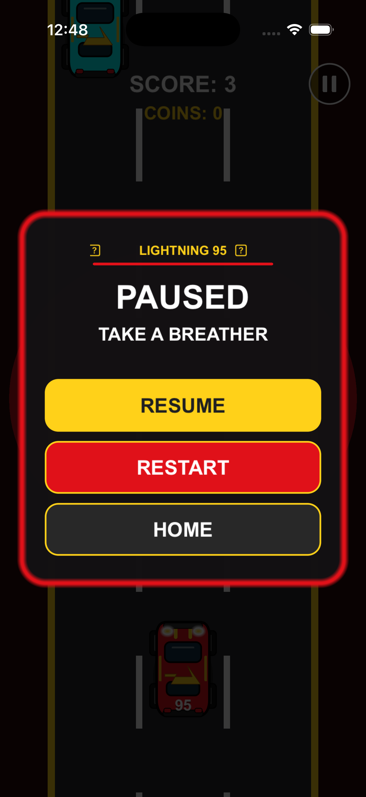
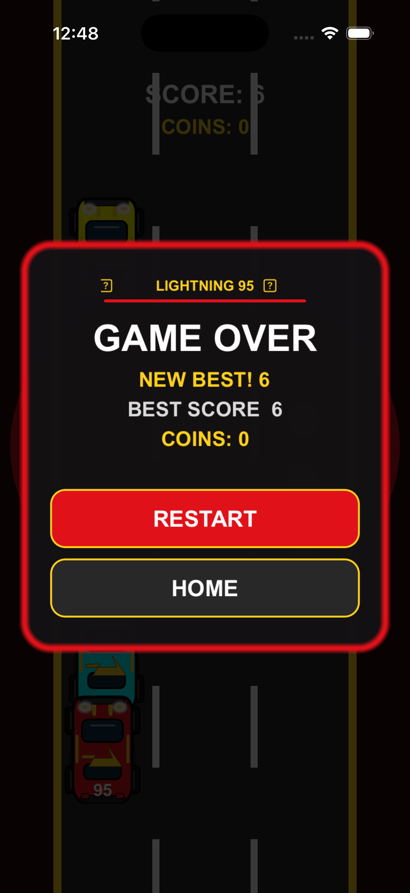

# 日専祭アプリ： 「Lightning」
• 学籍番号・氏名：
      • 26cm0142 ルワサンダガワ　ボルドエルデネ
> **チーム名**
> 　　「カーマニア」
> **AI利用レベル：** 2（生成コード可）
> **最終更新：** 2026-10-02
>
> **チーム : ** カーマニア (26cm0142 ルワサンダガワ　ボルドエルデネ, 26cm0134 ミン, 26cm0118　スワン)

> 💡 制作の進め方は担任の先生から案内があります。このファイルの項目は、担任の先生の指示で増えることがあります。

---

## 何ができるアプリか（3行）

1. 左右にスワイプして、迫ってくる車をよけながら走ることができます。

2. コインを集めてスコアを伸ばし、ニトロで一気に加速することができます。

3. 一時停止ボタンでいつでも休憩でき、自分のペースで楽しむことができます。

## 画面

## 使った文法・技術

（例：`@State`、`List`、`ForEach`、構造体、配列の `append` と `remove`）

## 生成AIの使い方（どの場面で、どう使ったか）

（例：画面の骨組みは ChatGPT に書いてもらった。削除ボタンが効かなかったので、原因を質問して直した。）

## 展示で工夫した点

（例：文字を大きくして、来場者が操作しやすいようにした。）
